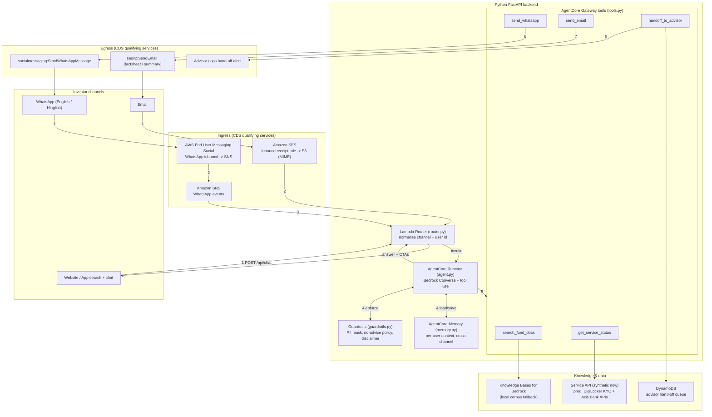
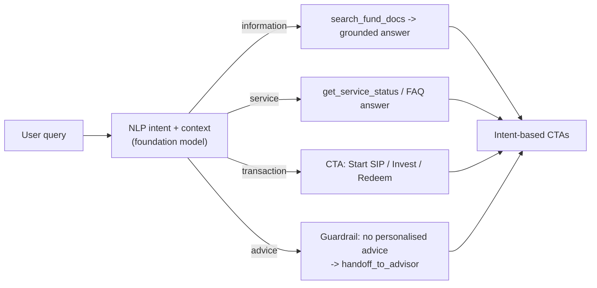

# MF Investor Assistant — Flow Diagram

This document maps the CDS reference architecture to the implementation in this
repository. The numbered steps match the "Request flow" legend in the
architecture diagram (`MF Investor Assistant – CDS Architecture.png`).

## End-to-end request flow

## Intent handling

## Step reference

| # | Architecture step | Where it lives |
|---|-------------------|----------------|
| 1 | Investor messages on WhatsApp / emails / uses web search | `channels` → `main.py` endpoints |
| 2 | End User Messaging publishes to SNS; SES stores email in S3 | `webhooks/*` + `router.normalise_*` |
| 3 | Lambda router normalises message and invokes the agent | `router.route()` |
| 4 | Agent loads Memory context and applies Guardrails | `agent.run_agent()` |
| 5 | Agent retrieves from KB and calls tools via the Gateway | `agent._run_bedrock_loop()` + `tools.py` |
| 6 | Reply on WhatsApp (text, buttons, factsheet PDF) | `tools.send_whatsapp()` |
| 7 | Factsheet / summary emailed via SES | `tools.send_email()` |
| 8 | "Talk to advisor": hand-off queued + SES alert | `tools.handoff_to_advisor()` |

## Confidential data (KYC / identity / transactions)

The Service API node is **synthetic** in this demo (`tools.get_service_status`,
`tools.complete_kyc`). In production, confidential investor details are not
generated or stored by this assistant — they come from authoritative,
consent-based sources:

- **DigiLocker** for identity and KYC (PAN + Aadhaar, address proof); only the
  verified result flows back to the agent — never raw document numbers.
- **Axis Bank / Axis AMC APIs** for SIP, redemption, folio and account state.

See [ARCHITECTURE.md §5](ARCHITECTURE.md#5-confidential-data-sources-kyc-identity-transactions).
